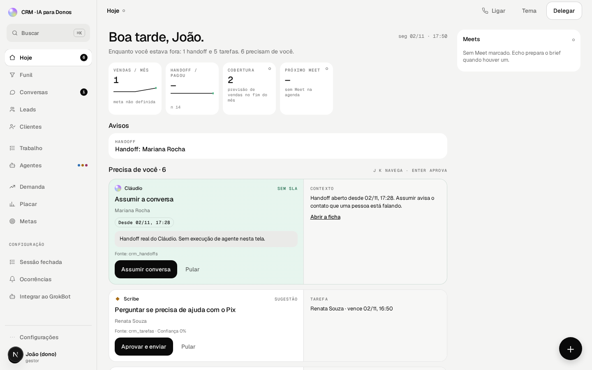
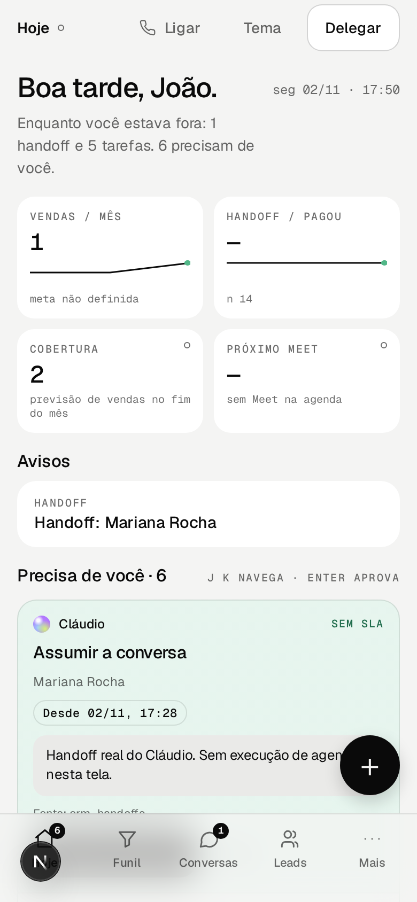
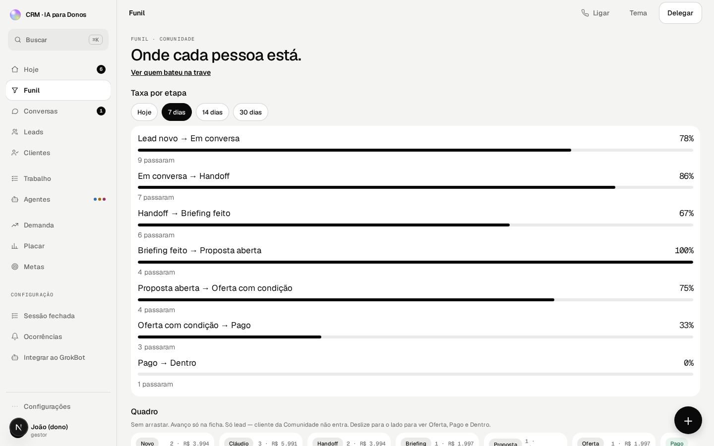
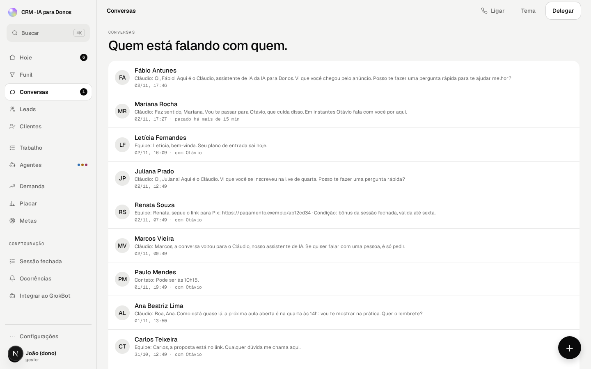
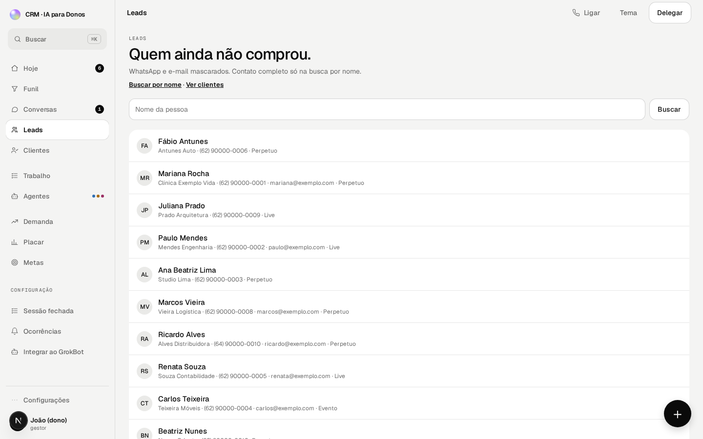
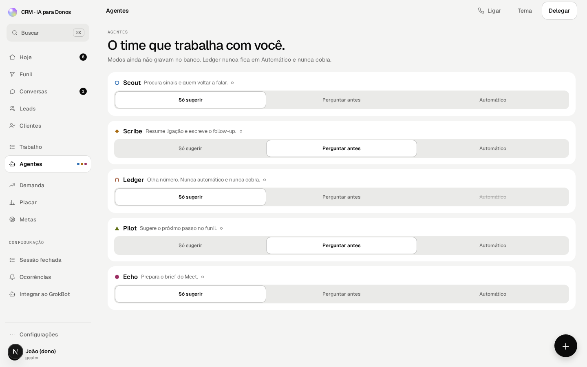
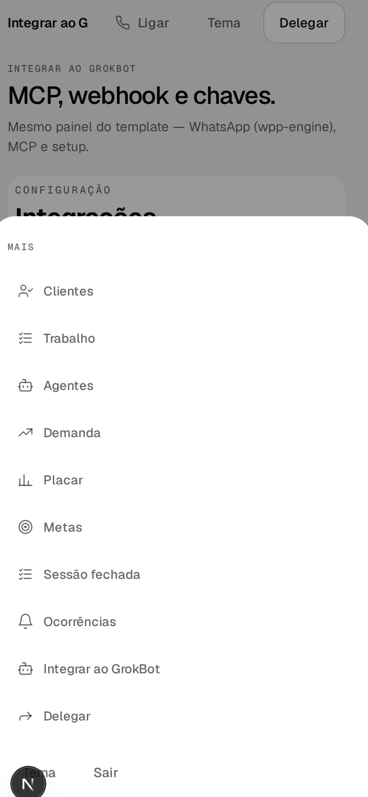

<p align="center">
  
</p>

<p align="center">
  <strong>The place where the owner sees what they need to see — and nobody else decides for them.</strong>
</p>

<p align="center">
  <a href="LICENSE"></a>
  <a href="https://github.com/oficina-ipd/crm-do-dono-template"></a>
  
  
  
  <a href="README.md"></a>
</p>

<p align="center">
  
</p>

<p align="center">
  <em>Versão em português:</em> <a href="README.md">README.md</a>
  ·
  <em>Install guide (PT-BR):</em> <a href="IMPLEMENTAR.md">IMPLEMENTAR.md</a>
</p>

---

## Table of contents

1. [Why I built this](#why-i-built-this)
2. [The owner’s problem](#the-owners-problem)
3. [What CRM do dono does](#what-crm-do-dono-does)
4. [WhatsApp: WPP Engine (recommended path)](#whatsapp-wpp-engine-recommended-path)
5. [Install (step by step, plain language)](#install-step-by-step-plain-language)
6. [Your data stays with you](#your-data-stays-with-you)
7. [Honest warnings (ban risk & privacy)](#honest-warnings-ban-risk--privacy)
8. [Questions I’ve already heard](#questions-ive-already-heard)
9. [Roadmap](#roadmap)
10. [How to contribute](#how-to-contribute)
11. [License](#license)
12. [Credits](#credits)

---

## Why I built this

I’m João. I sell, I answer, I close — and like every small-business owner, I also lost people inside WhatsApp.

It wasn’t a lack of leads. It was a lack of a **place**.

Chat mixed customers, curiosity, collections, and “hey, how are you?”. The funnel lived in a spreadsheet nobody updated. The bot talked too much. The human took over too late. And in the morning I opened my phone without knowing **who needed me now**.

**CRM do dono** is the answer I wanted for myself: one surface, what matters, running on **your** machine or **your** accounts — with **your** AI key, if you want one.

This is not a closed product selling miracles. It’s a template from the **IA para Donos** community, open under the MIT license, for you to install, adapt, and own.

> If your CRM needs an analyst before you can open it in the morning, it isn’t yours.

---

## The owner’s problem

In a small business, WhatsApp **is** the operation. It’s where the lead arrives, where price shows up (when it shouldn’t), where “I’ll think about it” dies in silence.

What I saw — and still see in many companies:

- A lead replies. Nobody takes over. Time passes.
- Cláudio (or any bot) talks price. The salesperson loses the conversation.
- A stuck card disappears in the list. Nobody flags it.
- The owner only finds the hole when the month closes — and then it’s too late.

Market CRMs solve for large teams with process and spare people. I wanted the opposite: **few screens, clear rules, the owner in command**.

---

## What CRM do dono does

Five screens I actually use. The rest exists, but these are the heart.

### Today (Hoje) — what needs you now




A good morning with what broke: handoff waiting, task due, stuck card. No vanity dashboard. No chart that doesn’t change your morning.

### Funnel (Funil) — where each person is



Stages of **your** business (not a textbook). Conversion per stage against **your** target. A board you don’t drag for sport: the card moves when the validation happened.

### Conversations (Conversas) — who’s talking to whom




Cláudio and the team in one place. Taking over notifies the contact. Handing back returns the bot. No “copy-paste from WhatsApp Web”.

### Leads — who hasn’t bought yet



A clean list. Full contact when you search by name. A record with enough to call, write, and keep the thread.

### Agents (Agentes) — the team that works with you



Seven clear roles: **Cláudio** (talks, doesn’t close), **Scout**, **Scribe**, **Ledger** (never charges alone), **Pilot**, **Eco**, and **Ember** (opportunity recycler). You pick the mode and can dedicate a stronger model specifically to Ember. The AI key, if any, is **yours**.

### Relance — mining stalled leads with real context

In **Relance** (`#/relance`), **Ember** reads stalled conversations one by one, crosses real history with your business content, and decides whether to reach out now or stay silent. When worth it, it sends the opening message inside your guardrails (rate limits, business hours, opt-out, and emergency stop) — without per-message approval and without accepting phone-only cold lists. Without an AI key, it never sends anything.

On the phone, the shell fits in a pocket: Today · Funnel · Conversations · Leads · More.



---

## WhatsApp: WPP Engine (recommended path)

I don’t want you running a WhatsApp server in the living room. The path I recommend is **[WPP Engine](https://wpp-engine.oneclient.com.br)** — account, key, QR, done.

<p align="center">
  <a href="https://wpp-engine.oneclient.com.br"></a>
</p>

### How you connect (simple)

1. In the CRM, under **Integrations › WhatsApp** (or on the home screen), click **Create WPP Engine account**.
2. Sign up in the console and grab the key (`wae_live_…`).
3. Paste the key **once** and the phone in international format (`+…`).
4. Click **Connect my WhatsApp**. The CRM validates the key, creates the session, shows the QR, and registers the webhook.
5. Scan the QR on your phone.

Technical contract: [`docs/wpp-engine-contrato.md`](./docs/wpp-engine-contrato.md) · full walkthrough (PT-BR): [`IMPLEMENTAR.md`](./IMPLEMENTAR.md).

### Other providers (optional)

If you already have your own stack, there is a **WAHA** adapter (Docker). It is not the path I recommend for beginners — it’s an escape hatch:

```bash
WHATSAPP_PROVIDER=waha
docker compose -f docker-compose.waha.yml up -d
```

The template default remains WPP Engine **without** a WhatsApp Docker box.

---

## Install (step by step, plain language)

You don’t need to be a developer. You need a computer, a terminal, and about half an hour the first time.

### Path A — one command (Docker)

With [Docker Desktop](https://www.docker.com/products/docker-desktop/) installed:

```bash
git clone https://github.com/oficina-ipd/crm-do-dono-template.git
cd crm-do-dono-template
docker compose up --build
```

Open **http://localhost:3000**, pick an operator, and use it. Demo mode: sample data in the browser. Nothing goes to the cloud until you ask.

To stop: `Ctrl+C` in the terminal (or stop the compose stack in Docker Desktop).

### Path B — Node on your machine (what I use day to day)

1. Install [Node.js 20+](https://nodejs.org/) (LTS).
2. In the terminal:

```bash
git clone https://github.com/oficina-ipd/crm-do-dono-template.git
cd crm-do-dono-template
npm install
npm run doctor
npm run dev
```

3. Open **http://localhost:3000**.

Without a `.env.local` file, the CRM runs in **demo**. That’s on purpose: you see it working before you wire a database or WhatsApp.

### When you want it “for real” (Supabase + Vercel)

That’s when accounts and keys show up. The long guide, in clear Portuguese, is **[IMPLEMENTAR.md](./IMPLEMENTAR.md)** — drop that file into Cursor and say: *follow until login works*.

What you create (when it’s time):

| Account | What for |
| --- | --- |
| GitHub | keep the code |
| Supabase | database and login |
| Vercel | the site live |
| Anthropic (optional) | agents with an LLM |
| WPP Engine (optional) | WhatsApp via QR |

You paste the keys. The repo does what can be automated (`npm run setup`, `npm run doctor`, migrations).

---

## Your data stays with you

- **Local demo:** state in the browser. No Supabase, no telemetry from me.
- **Production:** the database is **your** Supabase project. I don’t hold the key.
- **AI:** the Anthropic key (if you set one) is **yours**. Without a key, agents use local rules — more limited, but honest.
- **MCP (Cursor / GrokBot):** tools on your CRM, with a token **you** control. Local smoke test:

```bash
curl -s -H "Authorization: Bearer crm_demo_escrita" \
  -H "Content-Type: application/json" \
  -d '{"tool":"crm_funil_resumo","arguments":{}}' \
  http://localhost:3000/api/mcp/crm
```

Edit with AI: open the project in Cursor, read `AGENTS.md`, and ask in plain language what you want changed. Example:

> On the funnel screen, put a beacon on opportunities stuck with Cláudio.

---

## Honest warnings (ban risk & privacy)

I’d rather scare you now than see you without a number tomorrow.

### WhatsApp ban risk

WhatsApp automation in this template is **not** Meta’s official channel. A QR session (WPP Engine or WAHA) can be limited or banned by the platform. That isn’t a CRM bug — it’s the rule of unofficial WhatsApp.

What I do in practice:

- I don’t blast volume on day one.
- I respect spacing between automated messages (`cooldownMensagemHoras` in `crm.config.ts`).
- I prefer a human at price and close.
- If the session drops or shows banned/revoked, I stop and investigate — I don’t “reinject” messages.

Use at your own risk. If your volume needs the official API, this template still helps as a CRM; the channel changes.

### Privacy & respect for the contact (LGPD-minded)

- If someone asked to stop, **stop**. Cláudio has a path to end the chat.
- Don’t invent a score. No clear number in the conversation → ask again.
- WhatsApp and email are masked in the list; full contact on name search (and on the record for who is allowed).
- You are the controller of data in your Supabase. This repo doesn’t host anyone’s leads.

This is not legal advice. It’s the hygiene I demand from my own team.

---

## Questions I’ve already heard

**Do I need to pay to try it?**  
No. Clone, `npm run dev` or `docker compose up`, use the demo.

**Does it work without WhatsApp?**  
Yes. Funnel, Today, contacts, and agents (with rules) work. WhatsApp is the next step, not the ticket in.

**Does it work without an AI key?**  
Yes. Agents fall back to local rules. With an Anthropic key, tone improves — business logic stays in code.

**Does this replace HubSpot / Pipedrive?**  
For a small-business owner who lives in WhatsApp, I built **this**. If you need an app marketplace and a CRM committee, keep what you already know.

**Can I change stages and the product?**  
Yes. Edit `crm.config.ts`. Three inbound funnels and a sample main product ship as examples — swap them for yours.

**What if I break something?**  
`npm test` · `npm run doctor` · open an [issue](https://github.com/oficina-ipd/crm-do-dono-template/issues). A rough issue beats silence.

**Is there bulk email / automatic collections?**  
Not yet. It’s on the [roadmap](#roadmap) and in [`docs/EM-BREVE.md`](./docs/EM-BREVE.md). I won’t pretend I already shipped it.

---

## Roadmap

What’s **already** in this template (installable v3):

- Today, Funnel, Conversations, Leads/Clients, Agents, and the mobile shell
- Funnel domain, handoff, tasks, incidents
- Six agents with a DecisionEngine; optional LLM
- MCP for Cursor / GrokBot
- WhatsApp via WPP Engine (default) and WAHA (optional)
- Supabase schema + setup scripts

What’s coming in **separate deliveries** (promised on the live, no made-up dates):

1. Bulk email (Resend token rotation)
2. Collections agent (never mixed with Ledger)
3. Coach agent and v4 (native email marketing)

Live claims checklist: [`docs/LIVE-CHECKLIST.md`](./docs/LIVE-CHECKLIST.md).  
Change history: [`CHANGELOG.md`](./CHANGELOG.md).

---

## How to contribute

1. Open an [issue](https://github.com/oficina-ipd/crm-do-dono-template/issues) describing the hole (screen, step, what you expected).
2. Fork → branch `cursor/…` or `feat/…` → pull request against `main`.
3. Run `npm test` and `npm run doctor` before asking for review.
4. Don’t paste secrets (keys, tokens, `.env`) into issues or screenshots.

Product talk and live sessions: **IA para Donos** community. Code and bugs: GitHub.

---

## License

[MIT](./LICENSE). Use it, adapt it, sell **your** CRM on top. Design System 2027 and Geist fonts (OFL) ship with the template.

---

## Credits

**Oficina IPD · IA para Donos community**

Built with an owner’s stubbornness, not an investor deck.

- Template and live: João (IA para Donos)
- Design System 2027 · CRM v3 export
- WPP Engine: OneClient integration

If this helped you stop losing another lead to “I’ll think about it,” say so in the community. If it broke, open an issue. Both moves help me.

—
<p align="center">
  
  <br />
  <sub>CRM do dono · your funnel, your key, your number.</sub>
</p>
