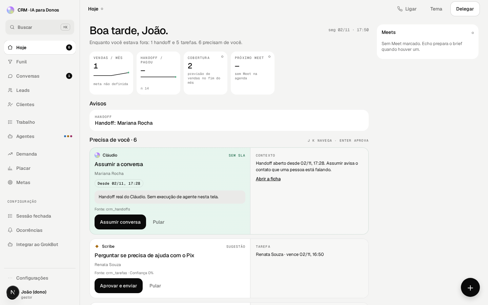
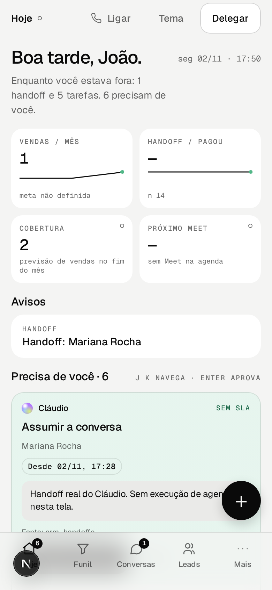
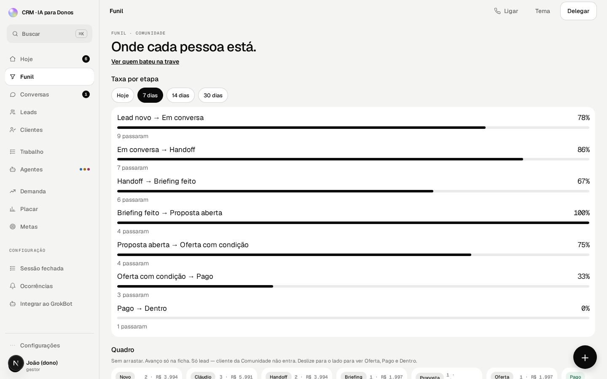
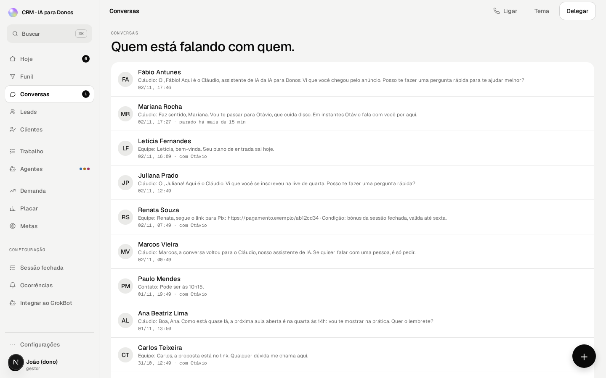
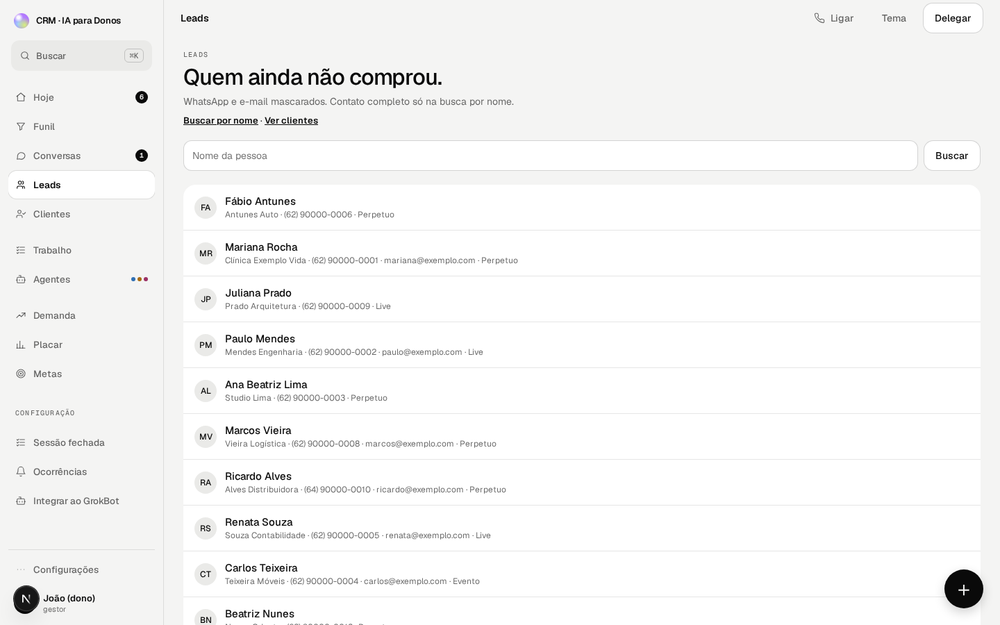
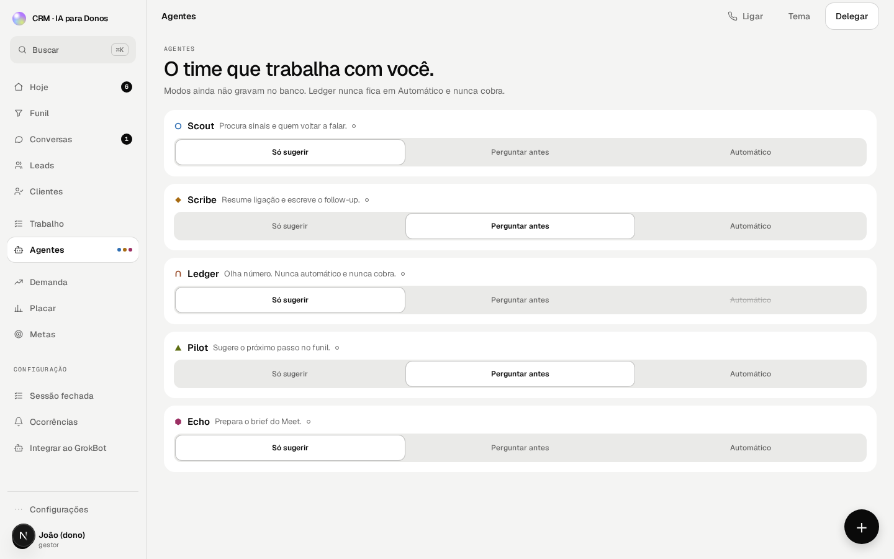
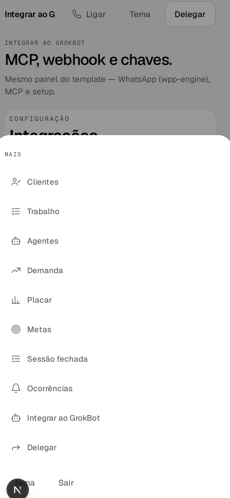

<p align="center">
  
</p>

<p align="center">
  <strong>O lugar onde o dono vê o que precisa ver — e ninguém mais decide por ele.</strong>
</p>

<p align="center">
  <a href="LICENSE"></a>
  <a href="https://github.com/oficina-ipd/crm-do-dono-template"></a>
  
  
  
  <a href="README.en.md"></a>
</p>

<p align="center">
  
</p>

<p align="center">
  <em>English version:</em> <a href="README.en.md">README.en.md</a>
  ·
  <em>Guia de instalação:</em> <a href="IMPLEMENTAR.md">IMPLEMENTAR.md</a>
</p>

---

## Sumário

1. [Por que eu fiz isso](#por-que-eu-fiz-isso)
2. [O problema do dono](#o-problema-do-dono)
3. [O que o CRM do dono faz](#o-que-o-crm-do-dono-faz)
4. [WhatsApp: WPP Engine (caminho recomendado)](#whatsapp-wpp-engine-caminho-recomendado)
5. [Instalação (passo a passo, sem jargão)](#instalação-passo-a-passo-sem-jargão)
6. [Seus dados ficam com você](#seus-dados-ficam-com-você)
7. [Avisos honestos (ban e LGPD)](#avisos-honestos-ban-e-lgpd)
8. [Perguntas que eu já ouvi](#perguntas-que-eu-já-ouvi)
9. [Roadmap](#roadmap)
10. [Como contribuir](#como-contribuir)
11. [Licença](#licença)
12. [Créditos](#créditos)

---

## Por que eu fiz isso

Eu sou o João. Eu vendo, eu atendo, eu fecho — e, como todo dono de negócio pequeno, eu também perdia gente no WhatsApp.

Não era falta de lead. Era falta de **lugar**.

O chat misturava cliente, curiosidade, cobrança e “oi, tudo bem?”. O funil vivia numa planilha que ninguém atualizava. O robô falava demais. O humano assumia tarde. E de manhã eu abria o celular sem saber **quem precisava de mim agora**.

O **CRM do dono** é a resposta que eu queria para mim: uma tela só, com o que importa, rodando na **sua** máquina ou na **sua** conta — com a **sua** chave de IA, se quiser.

Isto não é um produto fechado vendendo milagre. É um template da comunidade **IA para Donos**, aberto sob licença MIT, para você instalar, adaptar e mandar.

> Se o seu CRM precisa de um analista para você abrir de manhã, ele não é seu.

---

## O problema do dono

No negócio pequeno, o WhatsApp **é** a operação. É onde o lead chega, onde o preço aparece (quando não deveria), onde o “vou pensar” morre em silêncio.

O que eu via — e ainda vejo em muita empresa:

- Lead responde. Ninguém assume. O tempo passa.
- Cláudio (ou qualquer robô) fala preço. O vendedor perde o controle da conversa.
- Card “parado” some na lista. Ninguém apita.
- O dono só descobre o buraco quando o mês fecha — e aí já era.

CRM de mercado resolve para time grande, com processo e gente sobrando. Eu queria o contrário: **poucas telas, regras claras, o dono no comando**.

---

## O que o CRM do dono faz

Cinco telas que eu uso de verdade. O resto existe, mas estas são o coração.

### Hoje — o que pede você agora




Bom dia com o que estourou: handoff esperando, tarefa vencendo, card parado. Sem dashboard de vaidade. Sem gráfico que não muda a sua manhã.

### Funil — onde cada pessoa está



Etapas do seu negócio (não as de um manual americano). Taxa por etapa com a **sua** meta. Quadro sem arrastar por esporte: o card anda quando a validação aconteceu.

### Conversas — quem está falando com quem




Histórico do Cláudio e da equipe no mesmo lugar. Assumir avisa o contato. Devolver devolve o robô. Sem “copia e cola do WhatsApp Web”.

### Leads — quem ainda não comprou



Lista limpa. Contato completo quando você busca por nome. Ficha com o essencial para ligar, escrever e não perder o fio.

### Agentes — o time que trabalha com você



Seis papéis claros: **Cláudio** (conversa, não fecha), **Scout**, **Scribe**, **Ledger** (nunca cobra sozinho), **Pilot**, **Eco**. Você escolhe o modo. A chave de IA, se existir, é a **sua**.

No celular, a casca cabe no bolso: Hoje · Funil · Conversas · Leads · Mais.



---

## WhatsApp: WPP Engine (caminho recomendado)

Eu não quero que você monte servidor de WhatsApp na sala. O caminho que eu indico é o **[WPP Engine](https://wpp-engine.oneclient.com.br)** — conta, chave, QR, pronto.

<p align="center">
  <a href="https://wpp-engine.oneclient.com.br"></a>
</p>

### Como liga (simples)

1. No CRM, em **Integrações › WhatsApp** (ou na home), clique **Criar conta no WPP Engine**.
2. Faça o cadastro no console, pegue a key (`wae_live_…`).
3. Cole a key **uma vez** e o telefone no formato internacional (`+55…`).
4. Clique **Integrar meu WhatsApp**. O CRM valida a key, cria a sessão, mostra o QR e registra o webhook.
5. Escaneie o QR no celular.

Detalhes técnicos: [`docs/wpp-engine-contrato.md`](./docs/wpp-engine-contrato.md) · passo a passo completo: [`IMPLEMENTAR.md`](./IMPLEMENTAR.md).

### Outros provedores (opcional)

Se você já tem stack própria, existe adaptador **WAHA** (Docker). Não é o caminho que eu recomendo para quem está começando — é escape hatch:

```bash
WHATSAPP_PROVIDER=waha
docker compose -f docker-compose.waha.yml up -d
```

O padrão do template continua sendo o WPP Engine **sem** Docker de WhatsApp.

---

## Instalação (passo a passo, sem jargão)

Você não precisa ser programador. Precisa de um computador, um terminal e paciência de meia hora na primeira vez.

### Caminho A — um comando (Docker)

Com [Docker Desktop](https://www.docker.com/products/docker-desktop/) instalado:

```bash
git clone https://github.com/oficina-ipd/crm-do-dono-template.git
cd crm-do-dono-template
docker compose up --build
```

Abra **http://localhost:3000**, escolha um operador e use. Modo demo: dados de exemplo no navegador. Nada sobe para nuvem sem você pedir.

Para parar: `Ctrl+C` no terminal (ou pare o compose no Docker Desktop).

### Caminho B — Node no computador (o que eu uso no dia a dia)

1. Instale o [Node.js 20+](https://nodejs.org/) (versão LTS).
2. No terminal:

```bash
git clone https://github.com/oficina-ipd/crm-do-dono-template.git
cd crm-do-dono-template
npm install
npm run doctor
npm run dev
```

3. Abra **http://localhost:3000**.

Sem arquivo `.env.local`, o CRM roda em **demo**. Isso é de propósito: você vê a coisa funcionando antes de ligar banco ou WhatsApp.

### Quando quiser “de verdade” (Supabase + Vercel)

Aí sim entram contas e chaves. O roteiro longo, em português claro, está no **[IMPLEMENTAR.md](./IMPLEMENTAR.md)** — arraste esse arquivo no Cursor e diga: *siga até o login funcionar*.

Resumo do que você cria (quando for a hora):

| Conta | Para quê |
| --- | --- |
| GitHub | guardar o código |
| Supabase | banco e login |
| Vercel | site no ar |
| Anthropic (opcional) | agentes com LLM |
| WPP Engine (opcional) | WhatsApp por QR |

Você cola as chaves. O repositório faz o resto que dá para automatizar (`npm run setup`, `npm run doctor`, migrations).

---

## Seus dados ficam com você

- **Demo local:** estado no navegador. Sem Supabase, sem telemetria minha.
- **Produção:** o banco é o **seu** projeto Supabase. Eu não tenho a chave.
- **IA:** a chave Anthropic (se você colocar) é a **sua**. Sem chave, os agentes usam regras locais — mais limitados, mas honestos.
- **MCP (Cursor / GrokBot):** tools no seu CRM, com token que **você** controla. Exemplo de teste local:

```bash
curl -s -H "Authorization: Bearer crm_demo_escrita" \
  -H "Content-Type: application/json" \
  -d '{"tool":"crm_funil_resumo","arguments":{}}' \
  http://localhost:3000/api/mcp/crm
```

Editar com IA: abra o projeto no Cursor, leia `AGENTS.md` e peça em português o que quer mudar. Exemplo:

> Na tela de funil, ponha farol nas oportunidades com problema com o Cláudio.

---

## Avisos honestos (ban e LGPD)

Eu prefiro te assustar agora do que te ver sem número amanhã.

### Risco de ban no WhatsApp

Automação em WhatsApp **não é** canal oficial da Meta neste template. Sessão por QR (WPP Engine ou WAHA) pode ser limitada ou banida pela plataforma. Isso não é falha do CRM — é regra do jogo do WhatsApp não-oficial.

O que eu faço na prática:

- Não disparo massa no primeiro dia.
- Respeito intervalo entre mensagens automáticas (`cooldownMensagemHoras` no `crm.config.ts`).
- Prefiro o humano no momento de preço e fechamento.
- Se a sessão cair ou aparecer status de ban/revogada, eu paro e investigo — não “reinjeto” mensagem.

Use por sua conta e risco. Se o seu volume exige API oficial, este template ainda ajuda no CRM; o canal muda.

### LGPD e respeito ao contato

- Se a pessoa pediu para parar, **para**. O Cláudio tem caminho de encerrar.
- Não invente nota. Sem número claro na conversa, pergunta de novo.
- WhatsApp e e-mail mascarados na lista; contato completo na busca por nome (e na ficha com quem tem permissão).
- Você é o controlador dos dados no seu Supabase. Este repo não hospeda lead de ninguém.

Isto não é consultoria jurídica. É o mínimo de higiene que eu exijo do meu próprio time.

---

## Perguntas que eu já ouvi

**Preciso pagar para testar?**  
Não. Clone, `npm run dev` ou `docker compose up`, use o demo.

**Funciona sem WhatsApp?**  
Sim. Funil, Hoje, contatos e agentes (com regras) funcionam. WhatsApp é o próximo passo, não o ingresso.

**Funciona sem chave de IA?**  
Sim. Os agentes caem para regras locais. Com chave Anthropic, o tom melhora — a lógica de negócio continua no código.

**Isso substitui HubSpot / Pipedrive?**  
Para o dono de negócio pequeno que vive no WhatsApp, eu construí **isto**. Se você precisa de marketplace de apps e comité de CRM, use o que já conhece.

**Posso mudar as etapas e o produto?**  
Sim. Edite `crm.config.ts`. Três funis de entrada e o produto principal já vêm de exemplo — troque pelos seus.

**E se eu quebrar alguma coisa?**  
`npm test` · `npm run doctor` · abra uma [issue](https://github.com/oficina-ipd/crm-do-dono-template/issues). Melhor issue feia do que silêncio.

**Tem e-mail em massa / cobrança automática?**  
Ainda não. Está no [roadmap](#roadmap) e em [`docs/EM-BREVE.md`](./docs/EM-BREVE.md). Eu não finjo que já entreguei.

---

## Roadmap

O que **já está** neste template (v3 instalável):

- Telas Hoje, Funil, Conversas, Leads/Clientes, Agentes e casca mobile
- Domínio de funil, handoff, tarefas, ocorrências
- Seis agentes com DecisionEngine; LLM opcional
- MCP para Cursor / GrokBot
- WhatsApp via WPP Engine (padrão) e WAHA (opcional)
- Schema Supabase + scripts de setup

O que vem **em entregas separadas** (prometido na live, sem inventar prazo):

1. Disparo de e-mail em massa (rodízio de tokens Resend)
2. Agente de cobrança (nunca misturado com o Ledger)
3. Agente coach e v4 (e-mail marketing nativo)

Checklist do que eu afirmei em live: [`docs/LIVE-CHECKLIST.md`](./docs/LIVE-CHECKLIST.md).  
Histórico de mudanças: [`CHANGELOG.md`](./CHANGELOG.md).

---

## Como contribuir

1. Abra uma [issue](https://github.com/oficina-ipd/crm-do-dono-template/issues) descrevendo o buraco (tela, passo, o que esperava).
2. Fork → branch `cursor/…` ou `feat/…` → pull request contra `main`.
3. Rode `npm test` e `npm run doctor` antes de pedir review.
4. Não cole segredo (key, token, `.env`) em issue nem em print.

Discussão de produto e live: comunidade **IA para Donos**. Código e bugs: GitHub.

---

## Licença

[MIT](./LICENSE). Use, adapte, venda o **seu** CRM em cima. O design system 2027 e as fontes Geist (OFL) acompanham o template.

---

## Créditos

**Oficina IPD · comunidade IA para Donos**

Feito com teimosia de dono, não com deck de investidor.

- Template e live: João (IA para Donos)
- Design System 2027 · export CRM v3
- WPP Engine: integração OneClient

Se isto te ajudou a não perder mais um lead no “vou pensar”, conta na comunidade. Se quebrou, abre issue. Os dois movimentos me servem.

—
<p align="center">
  
  <br />
  <sub>CRM do dono · o seu funil, a sua chave, o seu número.</sub>
</p>
